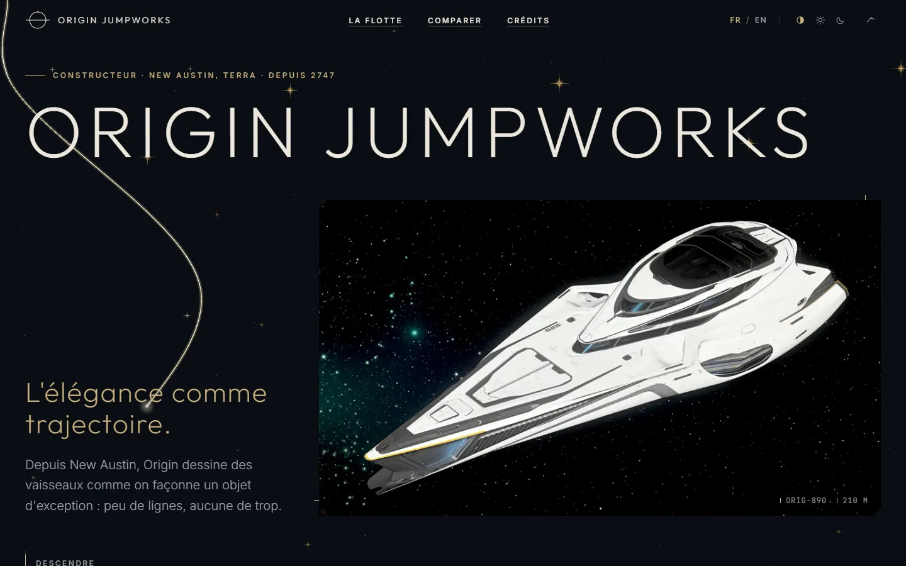
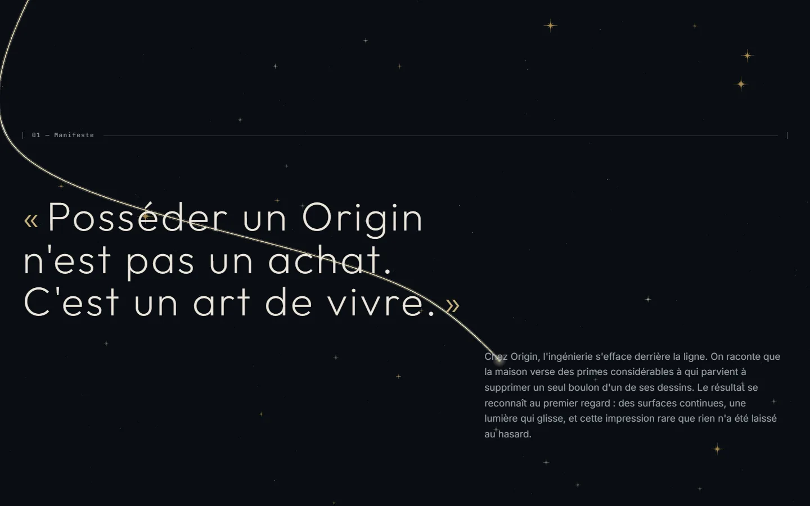
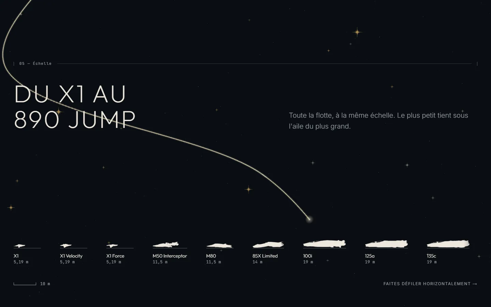
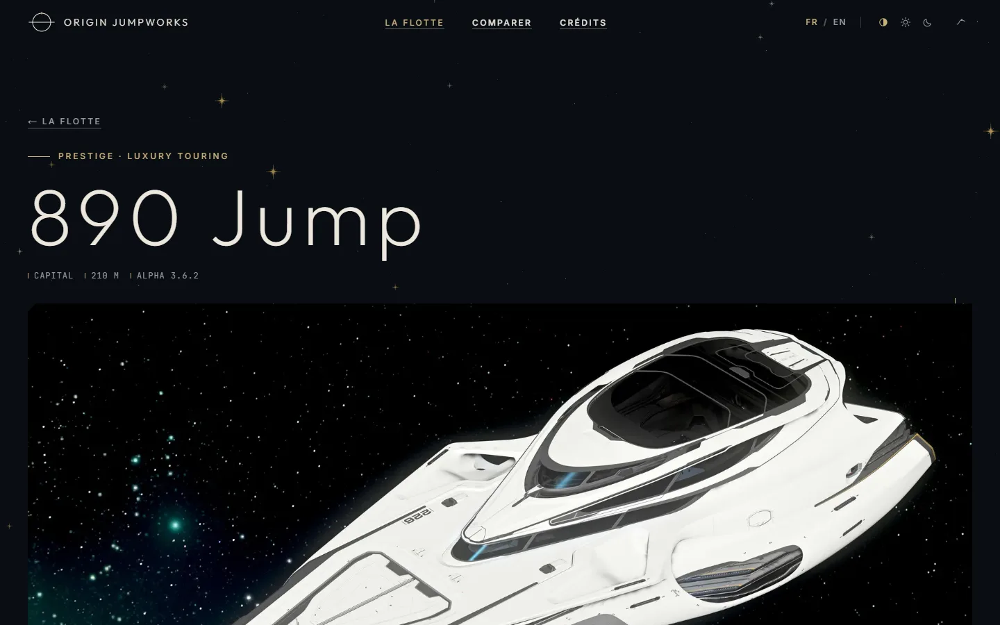
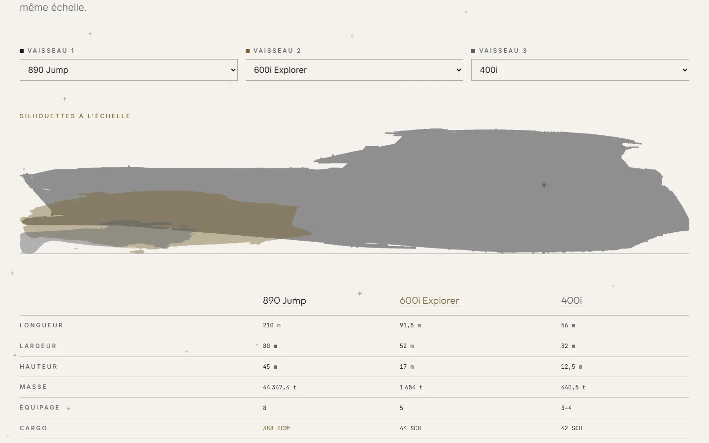
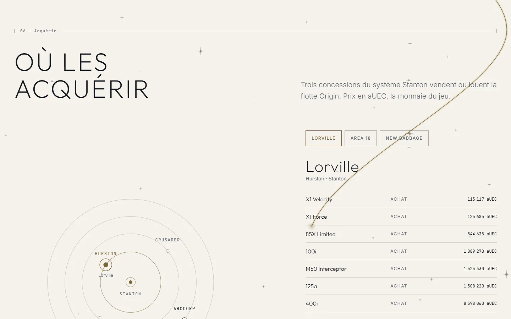
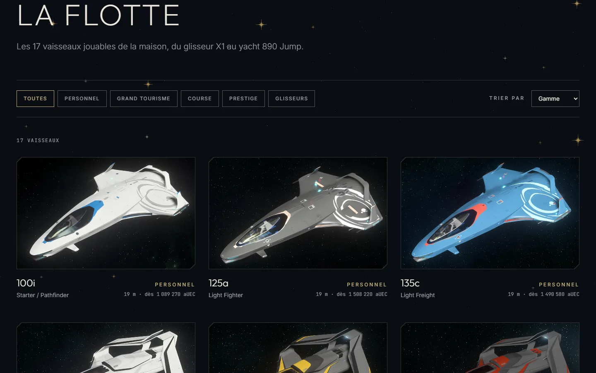
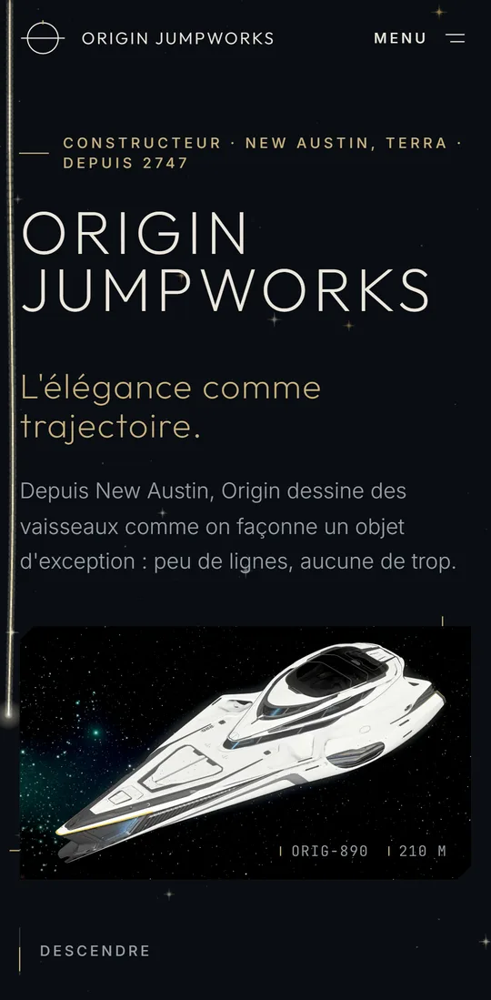
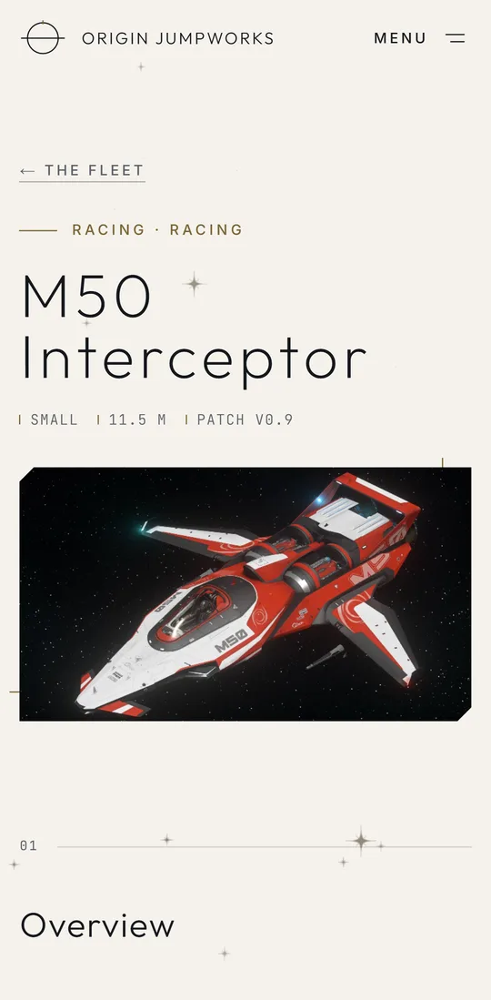

# Origin Jumpworks

Site vitrine **non officiel** consacré à Origin Jumpworks, le constructeur de vaisseaux de luxe de _Star Citizen_ : une longue descente au fil d'or, la flotte jouable, son histoire, et où l'acquérir en jeu.

Projet de portfolio réalisé par [Lilian Brossard](https://lilian-brossard.vercel.app/).



> This site is not endorsed by or affiliated with the Cloud Imperium or Roberts Space Industries group of companies. All game content and materials are copyright Cloud Imperium Rights LLC and Cloud Imperium Rights Ltd.. Star Citizen®, Squadron 42®, Roberts Space Industries®, and Cloud Imperium® are registered trademarks of Cloud Imperium Rights LLC. All rights reserved.

## En bref

- **Une DA « le trait d'abord »** : lignes d'un pixel, coins coupés à 45°, beaucoup de vide, mouvement lent et amorti. Thèmes clair (« Galerie ») et sombre (« Nuit sur New Austin »), contrastes AA vérifiés par un test.
- **Une couche 3D discrète** (React Three Fiber), dans un seul canvas derrière la page :
  - un **fil d'or** qui se dessine au défilement, passe par les filets numérotés de chaque section et redessine le monogramme en bas de page ;
  - un **ciel** de points fins et d'étincelles à quatre branches, en légère parallaxe ;
  - des **nuées de vaisseaux** qui traversent le ciel de temps en temps (cliquables : bonus caché).
- **17 vaisseaux jouables**, chacun avec sa fiche : image en relief (carte de profondeur WebGL), caractéristiques, prix en jeu par concession, galerie avec « lampe de showroom » et visionneuse accessible.
- **Un comparateur** à l'échelle, des transitions de page en « saut quantique », un changement de thème en lever de soleil.
- **Accessible et bilingue** : FR / EN, navigation au clavier, lecteurs d'écran, « Réduire les animations » (tout le mouvement a un repli statique).

|                                                                              |                                                                |
| ---------------------------------------------------------------------------- | -------------------------------------------------------------- |
|  |   |
|                    |  |
|         |                      |

<p align="center">
  
  
</p>

## Choix techniques

| Domaine           | Choix                                            | Pourquoi                                                                                      |
| ----------------- | ------------------------------------------------ | --------------------------------------------------------------------------------------------- |
| Cadre             | **Next.js 16** (App Router), **export statique** | Aucun serveur : 44 pages HTML (22 par langue) générées au build, hébergeables partout         |
| Langage           | TypeScript strict                                |                                                                                               |
| Styles            | **Tailwind CSS v4**, tokens CSS                  | Les mêmes tokens alimentent le CSS, la 3D et le test de contraste                             |
| 3D                | **three.js + React Three Fiber**, shaders GLSL   | Chargée après la page, dans un fichier à part ; caméra calée sur le document (1 unité = 1 px) |
| Relief des photos | WebGL brut (sans three.js)                       | Un simple décalage par carte de profondeur, sans alourdir les fiches                          |
| Défilement        | **Lenis**                                        | Désactivé en animations réduites                                                              |
| Transitions       | React `<ViewTransition>` + View Transitions API  | Repli : navigation normale                                                                    |
| Langues           | **next-intl**                                    | Sans middleware (export statique) : la langue est choisie dans le navigateur                  |
| Données           | **Zod** + script de collecte                     | Données figées dans le dépôt, validées au build et par les tests                              |
| Tests             | **Vitest**, **Playwright**, **axe-core**         | Données, parcours clés, accessibilité WCAG 2.2 AA dans les deux thèmes                        |

Quelques solutions maison dont je suis content :

- **Silhouettes et cartes de profondeur sans IA** : le script de collecte isole le vaisseau de son fond étoilé (seuil, plus grande forme, bouchage des trous, lissage). Il en tire la silhouette du comparateur d'échelle et la carte de profondeur du relief.
- **Le fil d'or relié au DOM** : la caméra suit le défilement à l'échelle du pixel, ce qui permet au fil de passer exactement par des repères posés dans la page (`data-thread`).
- **Correctif d'export** : Next 16.4 nomme mal certains fichiers de préchargement en export statique avec un segment dynamique ([`scripts/fix-export.mjs`](scripts/fix-export.mjs)).

## Qualité

- **Lighthouse (ordinateur)** : 97–99 en performance, 100 en accessibilité, bonnes pratiques et SEO.
- **axe** : aucune violation WCAG 2.2 A/AA sur 8 pages, thèmes clair et sombre.
- **40 tests unitaires et 32 tests de bout en bout**, lancés par la CI à chaque push.

Le détail (mesures mobile, budget JavaScript) est dans le [cahier des charges](docs/CAHIER_DES_CHARGES.md#9-performance-et-seo).

## Démarrer

Prérequis : Node 22+ et pnpm 10.

```bash
pnpm install
pnpm dev          # serveur de développement sur http://localhost:3000
```

| Commande                      | Rôle                                                          |
| ----------------------------- | ------------------------------------------------------------- |
| `pnpm dev`                    | Serveur de développement                                      |
| `pnpm build`                  | Site statique dans `out/`                                     |
| `pnpm preview`                | Sert `out/` en local (port 3000)                              |
| `pnpm check`                  | Lint, types, format et tests unitaires                        |
| `pnpm test` / `pnpm test:e2e` | Tests unitaires / de bout en bout (après `pnpm build`)        |
| `pnpm harvest`                | Collecte des données de la flotte (manuel)                    |
| `pnpm og`                     | Images de partage (1200 × 630) à partir des images collectées |
| `pnpm screenshots`            | Captures du README (site servi par `pnpm preview`)            |

## Données

Collectées **une fois**, à la main, puis commitées : le site en ligne ne fait aucun appel externe.

- Sources : [API du Star Citizen Wiki](https://api.star-citizen.wiki) (caractéristiques, prix [UEX](https://uexcorp.space)) et [starcitizen.tools](https://starcitizen.tools) (images, auteurs, licences). Aucun jeton nécessaire.
- `data/ships/*.json`, `data/locations.json`, `data/meta.json` ; descriptions françaises dans `data/i18n/descriptions.fr.json`.
- Images optimisées (AVIF/WebP, 960 et 1920 px), silhouettes et cartes de profondeur dans `public/ships/<slug>/`.

```bash
pnpm harvest                  # tout (les images déjà présentes ne sont pas réencodées)
pnpm harvest --skip-images    # caractéristiques et prix seulement
pnpm harvest --ship=890-jump  # un seul vaisseau
pnpm og                       # puis régénérer les images de partage
```

Réglages par vaisseau (gamme, ordre, nom affiché, seuil de silhouette, exclusions d'images) : [scripts/harvest/config.ts](scripts/harvest/config.ts).

## Déploiement

Site 100 % statique. Sur **Vercel** : importer le dépôt, aucun réglage nécessaire (Next.js est détecté, le dossier `out/` est servi). L'URL de production est reprise automatiquement pour les liens canoniques, le plan du site et les images de partage ; `NEXT_PUBLIC_SITE_URL` permet de la forcer (domaine personnalisé).

## Crédits et licences

- Code : licence [MIT](LICENSE).
- Textes repris de starcitizen.tools : CC BY-SA 4.0. Images : auteur et licence de chacune sur la page `/credits` du site.
- Logo « Made by the Community » : [fan kit officiel de Star Citizen](https://robertsspaceindustries.com/fankit), usage non commercial.
- Polices : Outfit, Inter, JetBrains Mono (SIL OFL).
